

  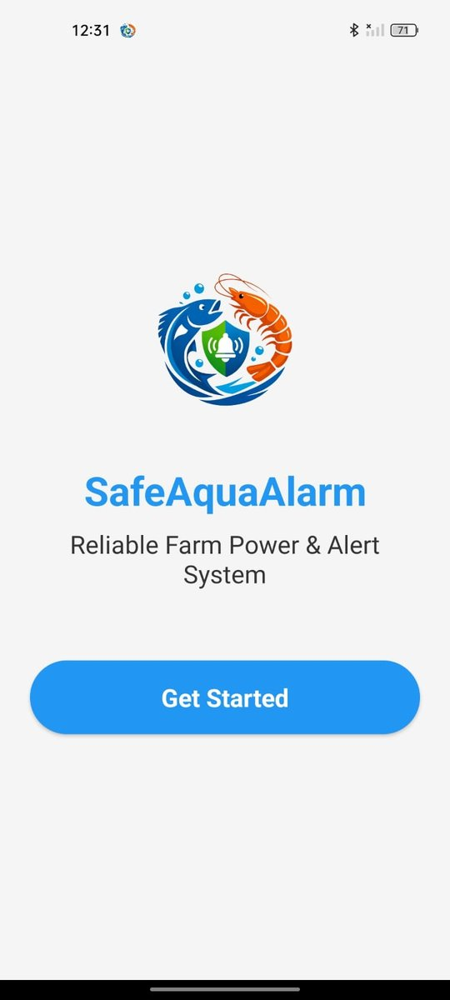

<h1 align="center">SafeAquaAlarm</h1>

<b>Reliable Farm Power & Alert System</b> 
An Android app that warns aquaculture farmers the moment the power goes out at their farm, so they can act before it's too late.

  
  
  
  

---

## The problem

Fish and shrimp ponds depend on electricity. Aerators keep oxygen in the water, and if the power fails, especially at night, a pond can run low on oxygen while the farmer is asleep and has no idea anything is wrong.

**SafeAquaAlarm turns two ordinary Android phones into a power-failure alarm.** One phone stays at the farm and watches the power. The other stays with the farmer and rings loudly the moment the power goes out.

---

## How it works

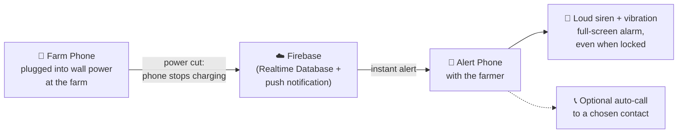

1. **Farm Phone:** an Android phone left at the farm, **plugged into the wall charger**. While it's charging, the power is on. When it suddenly switches to battery, the power has failed.
2. **Instant signal:** the Farm Phone updates the farm's status in **Firebase** and sends a push notification to every Alert Phone connected to that farm.
3. **Alert Phone:** the farmer's own phone shows a full-screen **EMERGENCY ALERT** with a loud siren and vibration, **even if the phone is locked or on silent**, until someone taps **Stop Alarm**.
4. **Pairing with a Farm Code:** each farm gets a unique code (for example `WSNIQ67Jcitj`). Typing it into an Alert Phone links the two. Several Alert Phones can watch the same farm.
5. **Farm Phone health check:** if the Farm Phone itself goes offline, the Alert Phone shows **"Farm Phone Not Responding"**, so silence never gets mistaken for "everything is fine."

> **Requirements:** two Android phones, both with an internet connection (mobile data or Wi-Fi). The Farm Phone must stay plugged into the wall charger.

---

## Screenshots

### Getting started
<table>
  <tr>
    <td align="center"> Welcome</td>
    <td align="center">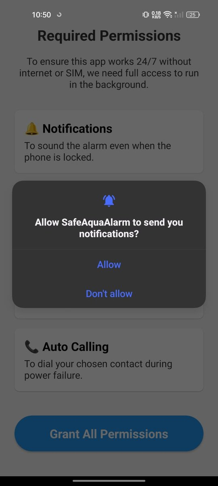 Permissions explained</td>
    <td align="center">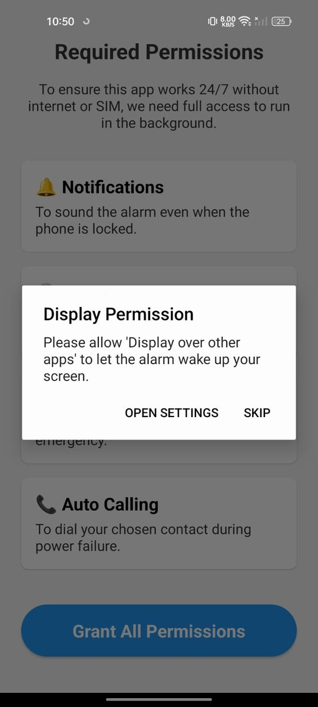 Wake the screen in an emergency</td>
    <td align="center">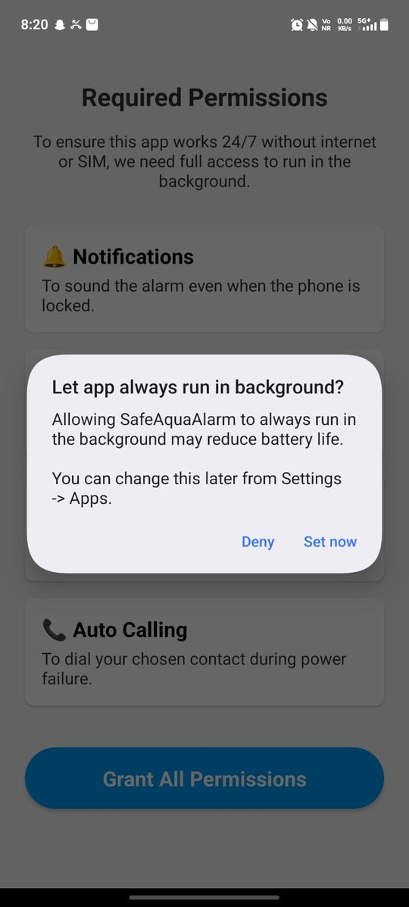 Run 24/7 in the background</td>
  </tr>
</table>

<table>
  <tr>
    <td align="center">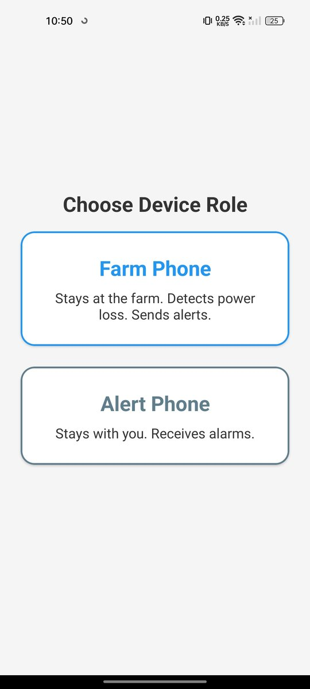 Choose a role: Farm Phone or Alert Phone</td>
  </tr>
</table>

### Farm Phone (stays at the farm)
<table>
  <tr>
    <td align="center">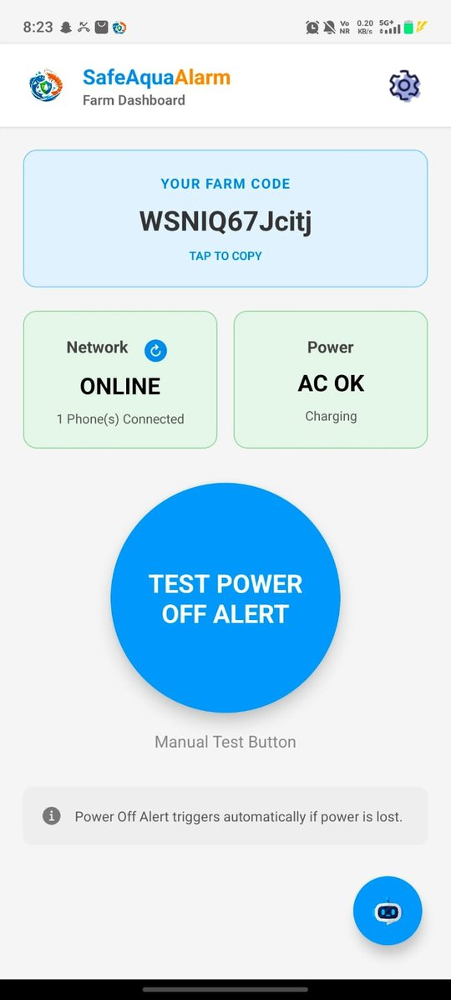 Power on (charging), 1 Alert Phone connected</td>
    <td align="center"> Power lost: running on battery</td>
    <td align="center">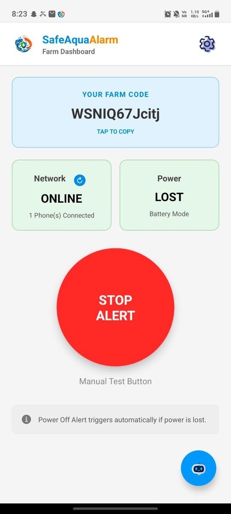 Alert active: stop it from the farm</td>
  </tr>
</table>

The Farm Phone shows the **Farm Code** (tap to copy), its **network** status, how many Alert Phones are connected, and the **power** status (AC OK / LOST). The big **Test Power Off Alert** button sends a test alarm, so the setup can be checked without switching off the power.

### Alert Phone (stays with the farmer)
<table>
  <tr>
    <td align="center">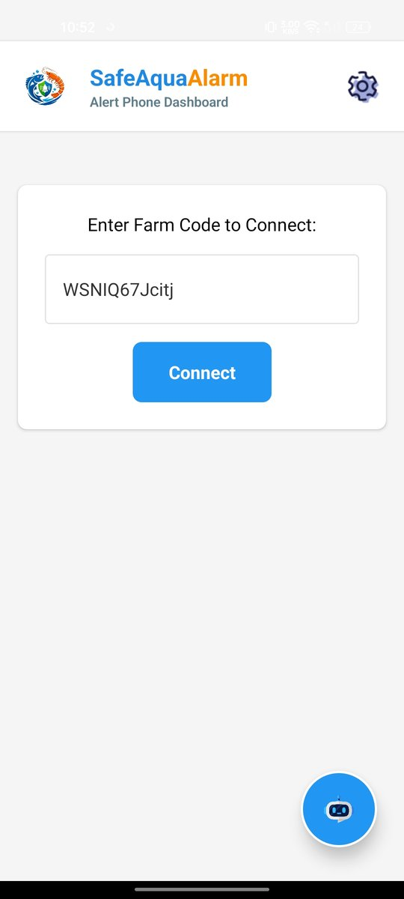 Connect with the Farm Code</td>
    <td align="center">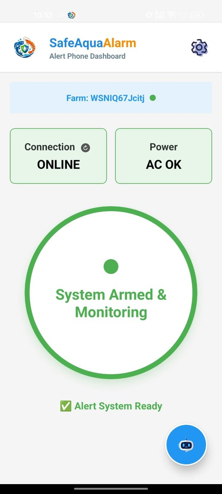 System armed and monitoring</td>
    <td align="center">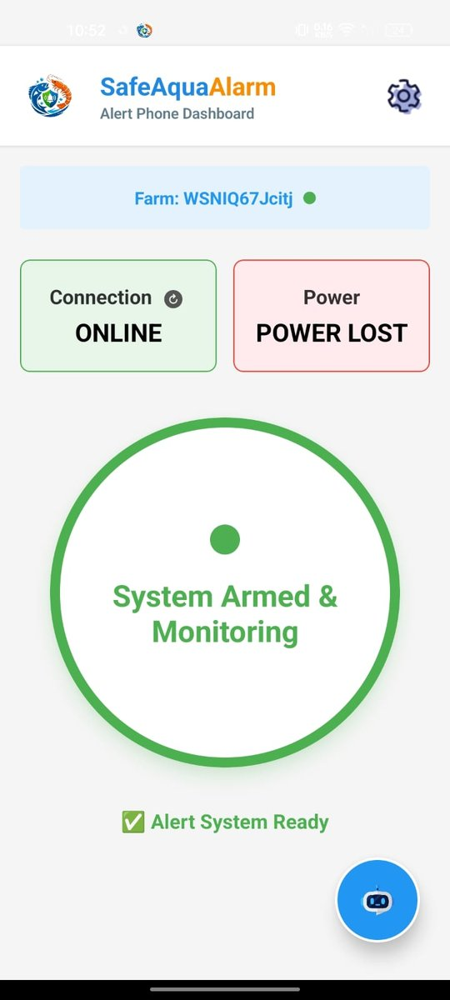 Power lost at the farm</td>
    <td align="center">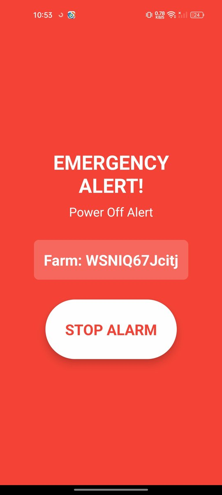 Full-screen emergency alarm</td>
  </tr>
</table>

### Settings and help
<table>
  <tr>
    <td align="center">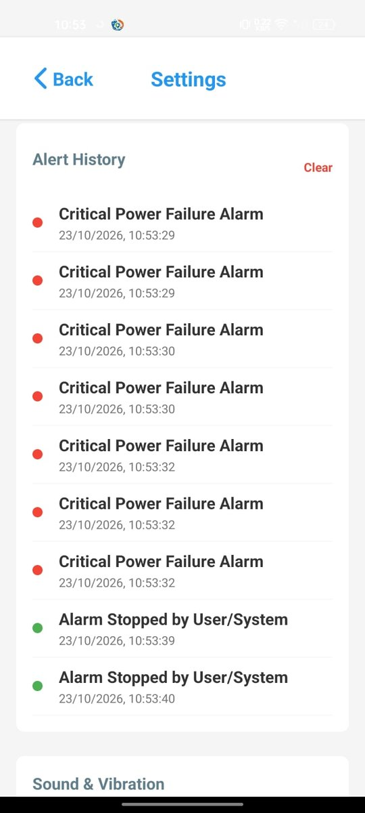 Alert history with timestamps</td>
    <td align="center">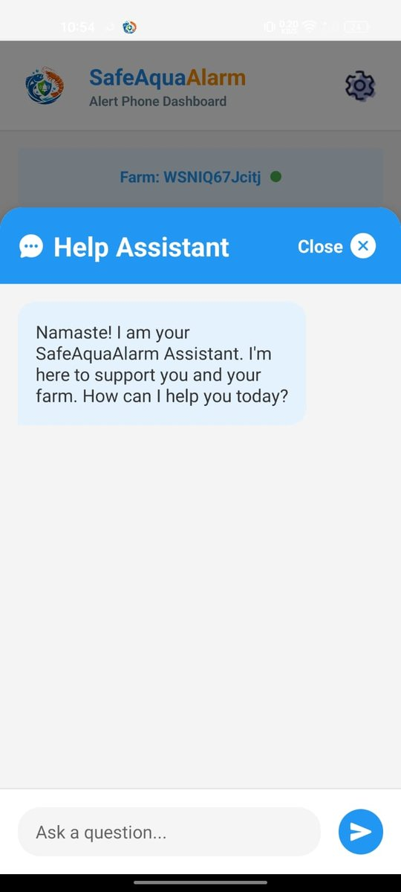 Built-in Help Assistant</td>
  </tr>
</table>

---

## Features

**Monitoring and alerts**
- Detects power cuts automatically from the Farm Phone's charging state
- Full-screen emergency alarm that **wakes the screen**, with a loud siren and vibration
- Critical sound mode that rings at **maximum volume** even when the phone is on silent
- Several Alert Phones can connect to one farm, so the whole family can be alerted
- Warns when the Farm Phone stops responding
- **Test Power Off Alert** button for checking the setup safely
- **Alert history**: every power failure and every stopped alarm, with date and time

**Settings**
- **Auto Call:** automatically phones a chosen emergency contact during a power failure
- Emergency contact picker from the phone's contacts
- Turn alerts off during maintenance (with a reminder to turn them back on)
- Option to skip alerts during chosen hours, for example during the day
- Keeps running after the phone restarts

**Ease of use**
- Two-tap setup: choose a role, then share the Farm Code
- Plain-language permission screens that explain *why* each permission is needed
- **Help Assistant** inside the app that answers common questions about setup and alerts

---

## Permissions and why they're needed

| Permission | Why |
|---|---|
| Notifications | To show the alarm, even on the lock screen |
| Display over other apps | To wake the screen and show the full-screen alarm in an emergency |
| Ignore battery optimization / run in background | So Android doesn't put the app to sleep: it has to watch 24/7 |
| Foreground service, wake lock | To keep monitoring and keep the alarm sounding |
| Start on boot | To start monitoring again automatically after the phone restarts |
| Vibrate | To vibrate during the alarm |
| Contacts | To choose the emergency contact for Auto Call |
| Phone calls | To auto-call the emergency contact |
| Internet | To send and receive alerts through Firebase |

---

## Tech stack

| Part | Technology |
|---|---|
| App | **React Native** with **Expo** (SDK 52, New Architecture), Hermes JavaScript engine |
| Navigation | React Navigation |
| Real-time data | **Firebase Realtime Database**: farm status, connected phones, alert history |
| Push alerts | **Firebase Cloud Messaging** |
| Full-screen alarm and background service | Notifee |
| Siren audio | expo-av |
| Power detection | expo-battery (charging state) |
| Emergency contact | expo-contacts |
| Package | `com.safeaqua.alarm` |

Built with AI-assisted development.

---

## Install (Android)

1. Download **SafeAquaAlarm.apk** from the [**Releases**](../../releases) page.
2. Open the file on the phone. If Android asks, allow **"Install unknown apps"** for your browser or file manager.
3. Install the app on **both** phones.
4. **On the farm phone:** open the app → **Get Started** → allow all permissions → choose **Farm Phone** → plug it into the wall charger. Note the **Farm Code**.
5. **On your phone:** open the app → allow all permissions → choose **Alert Phone** → enter the **Farm Code** → **Connect**.
6. Tap **Test Power Off Alert** on the Farm Phone and check that your phone rings.

> **Tip:** on phones from Xiaomi, Oppo, Vivo, Realme and Samsung, also check that battery saving or "auto-start" settings aren't stopping the app. These brands close background apps aggressively.

---

## Why Android only (for now)

All current users are on Android, and Android lets an app watch the charging state and run in the background around the clock, which is what this app needs.

## Roadmap

- [ ] **iPhone version.** iOS limits what apps can do in the background, so this needs a different design, and loud "critical alerts" that bypass silent mode need special permission from Apple.

---

## Author

**Praveen Chandu Pandu** · [GitHub](https://github.com/praveenchandupandu) · [LinkedIn](https://linkedin.com/in/praveenchandupandu)

© 2026 Praveen Chandu Pandu. All rights reserved.
